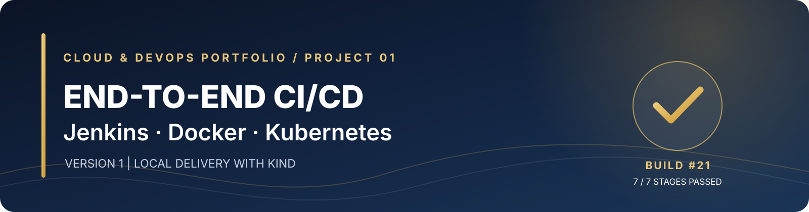
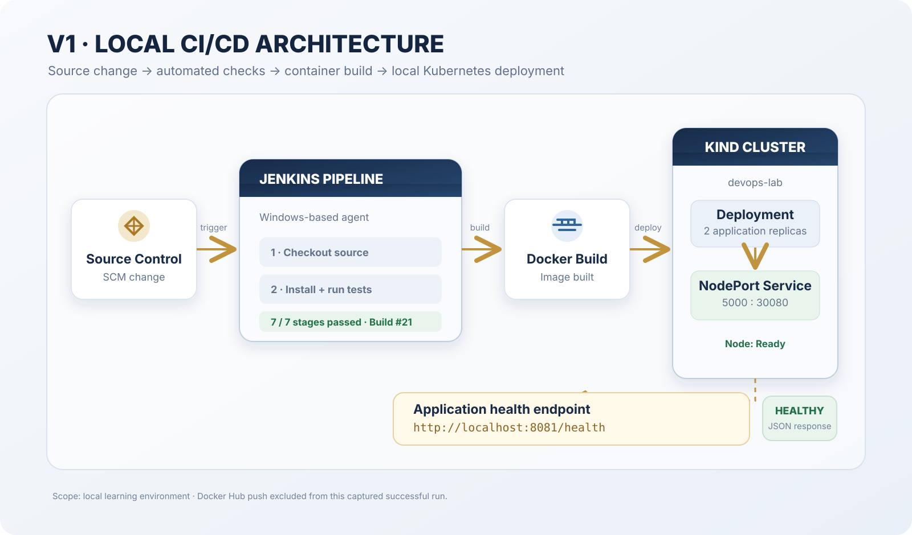
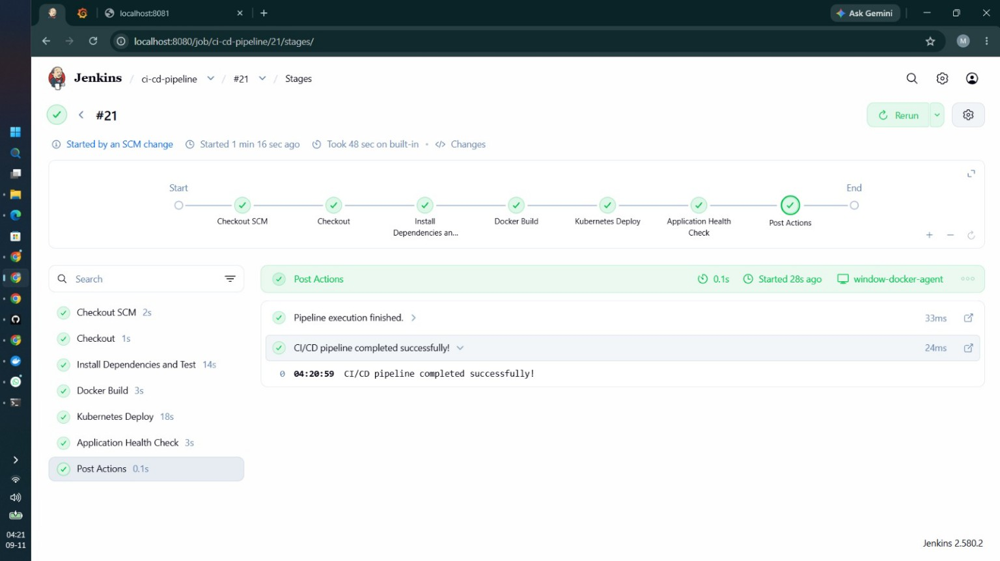
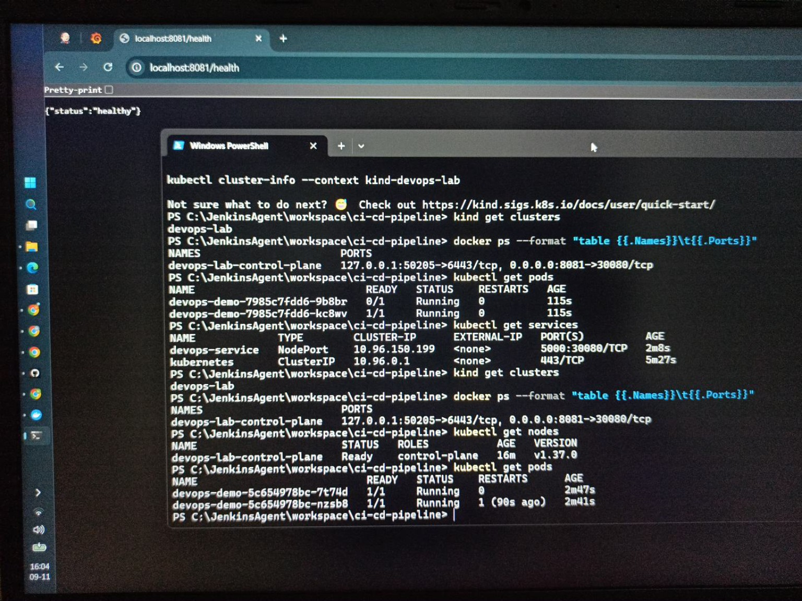

<div align="center">
  

  <h1>End-to-End CI/CD Pipeline</h1>
  <p><strong>Version 1 · Local delivery with Jenkins, Docker and Kind Kubernetes</strong></p>
  <p>
    
    
    
  </p>
  <p><em>Commit-to-cluster automation, tested on a local Windows development machine.</em></p>
</div>

---

## Project at a glance

This project demonstrates a local CI/CD workflow that takes an application change from source control through automated testing and container build, then deploys it to a local Kubernetes cluster and checks application health.

The successful evidence captured for this release is Jenkins **Build #21**, which completed all seven displayed stages in **48 seconds**. The application health endpoint returned `{"status":"healthy"}` at `http://localhost:8081/health`. The Kind node was `Ready`, and the later pod listing showed **two application pods, both `1/1 Running`**.

| Item | Verified result |
|---|---|
| Jenkins pipeline | Build #21 — successful |
| Pipeline stages | 7 of 7 passed |
| Recorded pipeline duration | 48 seconds |
| Dependency installation and tests | Stage passed |
| Docker image build | Stage passed |
| Kubernetes deployment | Stage passed |
| Application health endpoint | `{"status":"healthy"}` |
| Kind node | `Ready` |
| Application pods | 2 pods, both `1/1 Running` in the later check |
| Kubernetes Service | `NodePort`, displayed as `5000:30080/TCP` |
| Local application URL | `http://localhost:8081/health` |

> **Scope note:** Docker Hub push was intentionally removed from this V1 pipeline after an authentication failure. The Docker Build stage and local Kubernetes deployment passed, but this run does **not** demonstrate a successful registry push. Registry authentication and image publishing are tracked as pending work rather than presented as completed functionality.

## Architecture



The pipeline was run by Jenkins on a Windows-based agent. The local Kind cluster runs as a Docker container. The cluster's host port mapping exposed NodePort `30080` on host port `8081`.

## Pipeline stages

The Jenkins stage view recorded the following successful sequence:

| # | Stage | Recorded duration |
|---:|---|---:|
| 1 | Checkout SCM | 2s |
| 2 | Checkout | 1s |
| 3 | Install Dependencies and Test | 14s |
| 4 | Docker Build | 3s |
| 5 | Kubernetes Deploy | 18s |
| 6 | Application Health Check | 3s |
| 7 | Post Actions | 0.1s |

The stage durations are the values displayed by Jenkins in the captured Build #21 view. They may not add up exactly to the overall 48-second duration because of stage visualization and timing overhead.

## Evidence

The screenshots below are genuine captures from the completed run.

### 1. Jenkins Build #21 — all stages passed



*Evidence: successful Jenkins run, seven green stages, and the final pipeline success message.*

### 2. Application health and Kubernetes verification



*Evidence: health endpoint response, Kind cluster and node checks, NodePort service, and later pod output showing two `1/1 Running` pods. One pod had a restart count of 1 at the time of capture; its cause was not established.*

## Technology used

- **Jenkins** — pipeline orchestration and stage execution
- **Git / source control** — source checkout; Jenkins reported the run was started by an SCM change
- **Python / Flask** — application layer used in the project
- **pytest** — automated test stage
- **Docker** — container image build
- **Kind** — local Kubernetes cluster
- **Kubernetes** — Deployment, Pods and NodePort Service
- **Windows PowerShell** — commands and local Jenkins agent environment

## What this project demonstrates

- Structuring a multi-stage CI/CD pipeline.
- Automating dependency installation and test execution.
- Building a container image as part of a pipeline.
- Deploying an application to a local Kubernetes cluster.
- Exposing a Kubernetes Service through a NodePort and local host-port mapping.
- Checking application health after deployment.
- Verifying cluster, node, pod and service state with `kubectl`.

## Reproduce the verification checks

Run these from a terminal configured for the same Kind cluster:

```powershell
# Confirm the local Kind cluster
kind get clusters
kubectl cluster-info --context kind-devops-lab

# Confirm the Kubernetes node is Ready
kubectl get nodes

# Confirm application pods and restart counts
kubectl get pods -o wide

# Confirm the Service and NodePort
kubectl get services

# Check the application health endpoint
Invoke-RestMethod http://localhost:8081/health
```

Expected health response captured in this run:

```json
{"status":"healthy"}
```

The captured Service was named `devops-service`, type `NodePort`, and displayed `5000:30080/TCP`. The Kind cluster was named `devops-lab`.

## Known limitation and next improvement

**Not completed in V1:** Docker Hub authentication and image push.

Next registry-integration work:

1. Create or verify a Docker Hub access token.
2. Store the username and token in Jenkins Credentials (never in the Jenkinsfile or repository).
3. Test an authenticated `docker login` using the credential binding.
4. Add an image tag strategy, such as a build number or Git commit SHA.
5. Push the image and verify its digest in the registry.
6. Decide whether the Kind deployment should consume the published image or continue using a locally loaded image.

## Repository contents

```text
.
├── README.md
├── DEEP-DIVE.md
├── CHANGELOG.md
├── PROJECT-STATUS.md
├── assets/
│   ├── project-banner.svg
│   └── architecture.svg
├── docs/
│   ├── PIPELINE-WALKTHROUGH.md
│   ├── KUBERNETES-VERIFICATION.md
│   ├── TROUBLESHOOTING-AND-LEARNINGS.md
│   └── EVIDENCE-INDEX.md
└── evidence/
    ├── 01-jenkins-build-21-success.jpg
    └── 02-health-and-kubernetes-verification.jpg
```

This release package contains the documentation and the two supplied evidence screenshots. The application source, Dockerfile, Jenkinsfile and Kubernetes YAML were not supplied as files in this conversation, so they are **not fabricated or included as executable project files**. Add the exact files from your working repository before treating this as a complete source-code mirror.

## Version roadmap

| Version | Planned scope | Status |
|---|---|---|
| V1 | Local CI/CD: source checkout, tests, Docker build, Kind deployment and health check | **Completed; registry push excluded** |
| V2 | Cloud deployment on AWS with ECR and EKS | Planned |
| V3 | GitOps workflow with Argo CD, Helm and infrastructure as code | Planned |
| V4 | Security scanning and monitoring with tools such as Trivy, SonarQube, Prometheus and Grafana | Planned |

These are progressive versions of the same portfolio project, not claims that the future versions have already been implemented.

## Author

**Hafiz Mohammad Sunasara**  
Aspiring Cloud & DevOps Engineer  
[LinkedIn](https://linkedin.com/in/hafiz-mohammad-sunasara-118756366) · [GitHub](https://github.com/HafizMohammadSunasara)

---

*Built, tested and documented as a hands-on learning project. Results in this README are limited to the captured run and should not be interpreted as a production deployment.*
